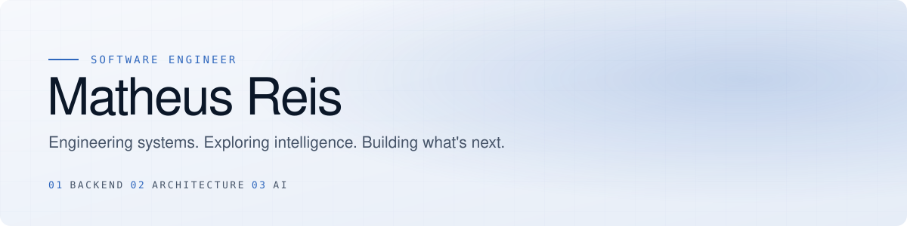
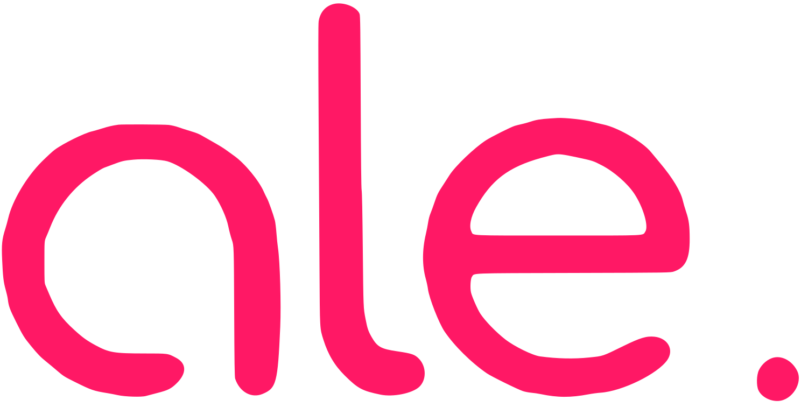

<picture>
  <source media="(prefers-color-scheme: dark)" srcset="assets/banner-dark.svg">
  
</picture>

<a href="README.pt-BR.md">Português (BR)</a> &nbsp;·&nbsp; <b>English</b>

I'm a Software Engineer focused on **reliable backend systems**, **scalable architectures** and, increasingly, **AI Engineering**. I started programming in 2021 and like understanding how systems work behind the interfaces: how components communicate and how to design solutions that stay scalable, resilient and sustainable over time.

Currently at **Loomi**, where I own the architecture and technical direction of **CX Bloom**, an omnichannel customer-service platform. Studying Computer Engineering at UFRN and expanding into LLMs, RAG, agents and MCP.

## Experience

<table><tr><td align="left" valign="top" width="25%"><picture><source media="(prefers-color-scheme: dark)" srcset="assets/mgetech-dark.png"></picture> <b>MGETech</b> </td><td align="left" valign="top" width="25%"> <b>Nexus</b> ALE Santa Catarina</td><td align="left" valign="top" width="25%"> <b>VILT</b> Porto Seguro</td><td align="left" valign="top" width="25%"><picture><source media="(prefers-color-scheme: dark)" srcset="assets/bloom-dark.svg"></picture> <b>Loomi</b> CX Bloom · current</td></tr></table>

## Technologies

**Backend** 
          

**Architecture** 
      

**AI Engineering** 
    

**Cloud & Data** 
          

## Selected work

<table><tr><td width="150" align="center" valign="middle"><picture><source media="(prefers-color-scheme: dark)" srcset="assets/bloom-dark.svg"></picture></td><td><b>CX Bloom</b> Omnichannel customer-service platform with AI, where I own the architecture and technical direction. <code>Event-driven · Clean Architecture · WebSockets</code></td></tr><tr><td width="150" align="center" valign="middle"></td><td><b>Porto Seguro</b> Scalable APIs and microservices for a high-demand insurance platform, with asynchronous messaging and serverless. <code>Node.js · RabbitMQ · AWS Lambda</code></td></tr><tr><td width="150" align="center" valign="middle"></td><td><b>ALE Santa Catarina</b> Core microservice for courses and access control on an education platform used by large institutions. <code>NestJS · AWS S3 · Data streams</code></td></tr></table>

Professional projects are private; details are limited to what can be shared publicly.

## Learning

- **Computer Engineering**, UFRN (in progress)
- Rocketseat: AI for Devs, Go, Professional Node.js and Machine Learning (in progress)
- System Design, by Augusto Galego (in progress)
- Rocketseat micro-certificates: Node.js Runtime Fundamentals and Introduction to AI
- Full Cycle 3.0 and Cloud Training

## Contact

[LinkedIn](https://www.linkedin.com/in/matheus-reis-443817264/) · [Email](mailto:contatodevvmatheus@gmail.com)
