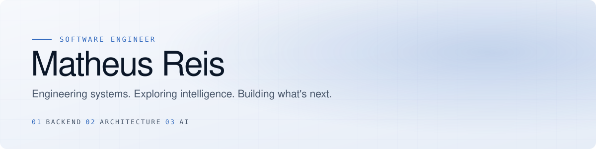
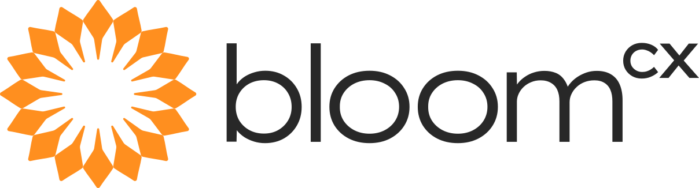
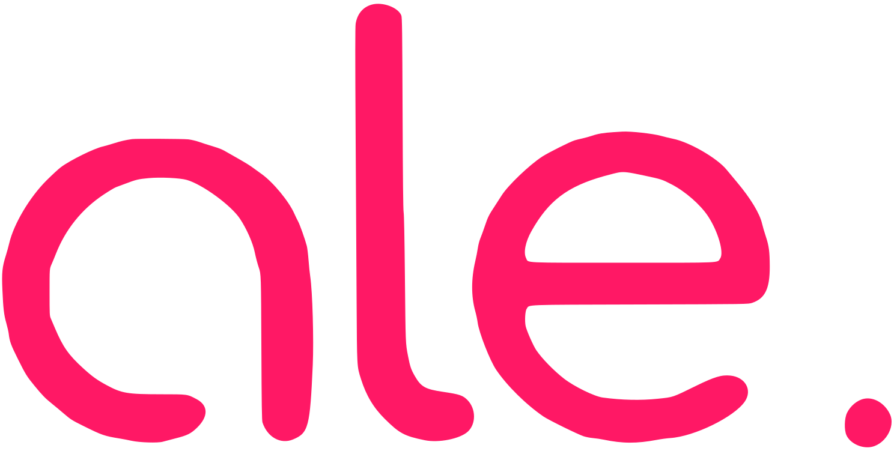

<picture>
  <source media="(prefers-color-scheme: dark)" srcset="assets/banner-dark.svg">
  
</picture>

<b>Português (BR)</b> &nbsp;·&nbsp; <a href="README.md">English</a>

Sou Engenheiro de Software com foco em **sistemas backend confiáveis**, **arquiteturas escaláveis** e, cada vez mais, **Engenharia de IA**. Comecei a programar em 2021 e gosto de entender como os sistemas funcionam por trás das interfaces: como os componentes se comunicam e como projetar soluções que continuem escaláveis, resilientes e sustentáveis no longo prazo.

Hoje na **Loomi**, onde sou responsável pela arquitetura e pela direção técnica do **CX Bloom**, uma plataforma omnichannel de atendimento. Curso Engenharia da Computação na UFRN e estou expandindo para LLMs, RAG, agentes e MCP.

## Tecnologias

**Backend** 
          

**Arquitetura** 
      

**Engenharia de IA** 
    

**Cloud e Dados** 
          

## Trabalhos selecionados

<table><tr><td width="150" align="center" valign="middle"><picture><source media="(prefers-color-scheme: dark)" srcset="assets/bloom-dark.svg"></picture></td><td><b>CX Bloom</b> Plataforma omnichannel de atendimento com IA, na qual sou responsável pela arquitetura e direção técnica. <code>Event-driven · Clean Architecture · WebSockets</code></td></tr><tr><td width="150" align="center" valign="middle"></td><td><b>Porto Seguro</b> APIs e microsserviços escaláveis para uma plataforma de seguros de alta demanda, com mensageria assíncrona e serverless. <code>Node.js · RabbitMQ · AWS Lambda</code></td></tr><tr><td width="150" align="center" valign="middle"></td><td><b>ALE Santa Catarina</b> Microsserviço central de cursos e controle de acesso em uma plataforma educacional usada por grandes instituições. <code>NestJS · AWS S3 · Data streams</code></td></tr></table>

Os projetos profissionais são privados; os detalhes se limitam ao que pode ser divulgado publicamente.

## Em aprendizado

- **Engenharia da Computação**, UFRN (em andamento)
- Rocketseat: IA para Devs, Go, Node.js Profissional e Machine Learning (em andamento)
- System Design, com Augusto Galego (em andamento)
- Micro-certificados Rocketseat: Fundamentos do Runtime (Node.js) e Introdução à IA
- Full Cycle 3.0 e Cloud Training

## Contato

[LinkedIn](https://www.linkedin.com/in/matheus-reis-443817264/) · [E-mail](mailto:contatodevvmatheus@gmail.com)
